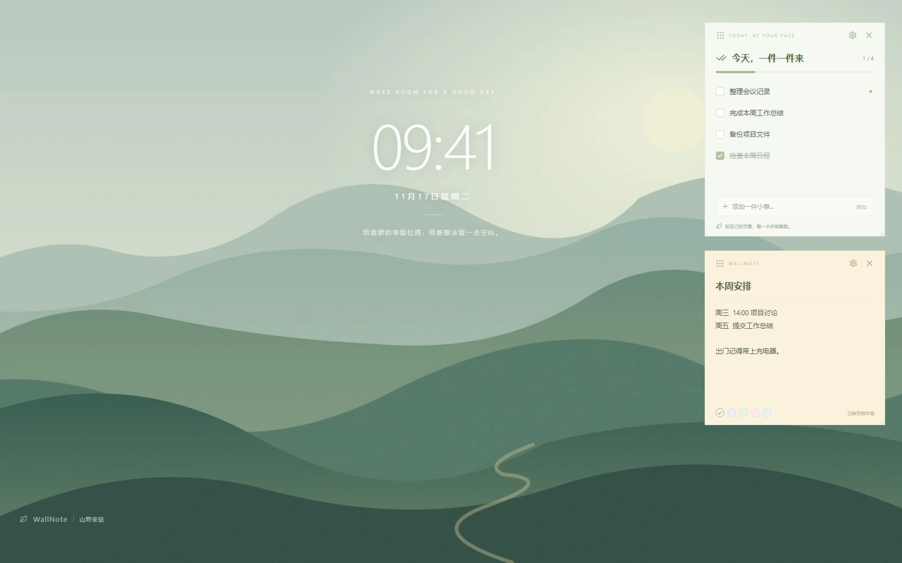

<div align="center">
  
  <h1>WallNote</h1>
  <p>Windows 桌面日历、时间安排、便签与待办。</p>
  <p><sub>Windows x64 · Electron + React · 本地存储</sub></p>
</div>



时间安排、日历、待办和便签默认分三栏排列。模块内的左右键只交给模块：即使和桌面图标重叠，也不会选中或打开图标。模块外仍可照常操作 Windows 桌面。点击图钉可将模块置于其他窗口上方。

## 功能

- **壁纸**：12 张内置壁纸，支持本地导入、收藏和多显示器。新作包括岬角灯塔、雪线、竹间月、秋日梯田、套色习作和潮汐线。
- **日历**：切换月份、选择日期，查看、添加和编辑日程。
- **时间安排**：按小时查看选中日期的安排，与日历实时同步。
- **便签**：直接编辑、换色和自动保存；多张便签在右侧面板切换，不再堆叠。
- **待办**：添加任务、勾选完成、标记重要，支持筛选和排序。
- **外观**：平滑圆角、毛玻璃背景和细滚动条，支持不同屏幕缩放比例。
- **数据**：保存在本地，无需登录，可离线使用，支持 JSON 备份与恢复。
- **手机日历**：同一 Wi-Fi 自动发现 Android 手机，首次确认配对后自动重连，可同步显示并提交新增、修改。
- **社区日报**：订阅 GitHub 公开仓库或标签，按日查看新 PR、合并动态和待认领 Issue。可用自己的 DeepSeek API Key 生成带来源的中文导读。
- **文件抽屉**：自动分类个人桌面和公共桌面的文件、文件夹与应用快捷方式。可选隐藏系统桌面图标。
- **模块布局**：直接在桌面拖动卡片，靠近工作区或相邻模块时出现吸附线。也可打开工作台的「整理布局」，可视化摆放六种模块。
- **内存**：桌面共享渲染进程，只加载使用中的模块。双屏四模块、开启 Wi-Fi 接收服务的安装包构建实测私有内存约 238 MB，详见[测量说明](docs/performance.md)。

## 下载安装（Windows x64）

[下载最新安装版](https://github.com/zihayi/WallNote/releases/latest)。选择 `WallNote-Setup-<版本>-x64.exe`，运行安装向导。默认安装到当前用户，也可选择安装目录。安装后可从开始菜单或桌面快捷方式启动，无需另装 Node.js 或 Python。

- **更新或从旧便携版迁移**：先从托盘退出 WallNote，再运行新安装包。同一 Windows 用户的日程、便签和手机配对信息会继续沿用。
- **登录时启动**：安装后可在「偏好设置 → 开机启动」开启，默认关闭。
- **卸载**：在 Windows「设置 → 应用 → 已安装的应用」中卸载 WallNote。默认保留 `%APPDATA%\WallNote` 下的个人数据。
- Release 附有同名 `.sha256` 文件，可用 `Get-FileHash .\WallNote-Setup-<版本>-x64.exe -Algorithm SHA256` 核对下载。

## 从源码运行

需要 **Windows x64**、**Node.js 22.12+** 和 **.NET Framework 4.x**。开发模式下使用手机同步还需要 Python 3.10+ 和 `cryptography`。

```powershell
git clone https://github.com/zihayi/WallNote.git
cd WallNote
npm ci
npm run dev
```

启动后按 `Win + D` 查看桌面。需要同时打开管理面板时，运行 `npm run dev -- --manage`。

## 操作

| 操作 | 入口 |
| --- | --- |
| 打开管理面板 | 双击托盘图标，或 `Ctrl + Alt + W` |
| 新建桌面便签 | 托盘右键 → 新建桌面便签 |
| 添加日程 | 点击时间表中的小时，或日历选中日期旁的 `+` |
| 在桌面输入日程 | 未置顶时会打开可输入文字的独立小窗；保存后桌面自动更新 |
| 更换壁纸 | 管理面板 → 壁纸库 → 设为桌面壁纸 |
| 置顶组件 | 点击组件右上角的图钉 |
| 移动、缩放组件 | 拖标题栏移动，拖边缘或四角调整大小，松手自动保存，无需置顶 |
| 吸附与微调 | 靠近工作区边缘、中线或其他模块边缘时吸附；按住 Alt 开始拖动可临时自由摆放，拖动中 Esc 撤销。也可在「整理布局」关闭自动吸附并应用 |
| 整体编排 | 工作台 → 整理布局；勾选模块、拖动卡片或调整边角，点「应用布局」保存；「取消」丢弃这次编排 |
| 查看手机连接 / 配对 | 点击桌面日历标题栏或管理面板右上角的「手机同步」 |
| 暂停或退出 | 托盘右键菜单 |

关闭管理面板后，程序继续在后台运行。窗口淡入淡出、组件收起和图钉反馈会跟随系统的减少动态效果设置。暂停或退出后显示原来的系统壁纸。更新版本前请先退出旧版。

升级会应用新的居中布局并保留内容。也可在「偏好设置 → 重置桌面组件位置」重新排列。

## 构建

```powershell
npm test          # 数据与持久化测试
npm run build     # 构建应用
npm start         # 运行构建后的应用
npm run dist      # 生成 Windows x64 安装程序和 SHA-256 校验文件
```

正式发行只上传 `release/WallNote-Setup-<版本>-x64.exe` 和同名 `.sha256` 文件。`npm run test:ui` 检查界面，`node scripts/smoke-layer.mjs` 检查层级与多屏尺寸；`npm run test:desktop` 会短暂操作鼠标键盘以验证真实桌面交互。

安装包内置 Wi-Fi 接收服务。构建前在 Python 环境执行 `python -m pip install -r receiver/requirements-build.txt`。仓库的 `receiver/` 已包含构建所需源码，无需其他本地工程。可用 `CALENDAR_BUILD_PYTHON` 指定构建用 Python，开发模式下用 `CALENDAR_PYTHON` 指定解释器。

## 社区日报与模块布局

1. 打开管理面板「社区日报 → 订阅设置」。预设为 `llvm/llvm-project` 全仓和同仓的 `mlir` 标签；可改为最多 3 个公开仓库/标签组合。
2. 点击「生成日报」即可查看近 24 小时仍开放的新 PR、已合并的 PR，以及当前未指派的 `good first issue` / `help wanted`。每个订阅每类取最新的最多 8 条；重叠订阅按仓库和编号去重。可点标题打开原文，或点击 `+` 加入本地待办。
3. 需要中文导读时，在订阅设置填入自己的 DeepSeek API Key、选择模型和关注方向并开启 AI。每期一次模型请求生成简短总览和逐条中文摘要。默认只发送关注方向和公开元数据；也可以勾选附带公开说明摘录（每条最多 480 字符）。在桌面卡片内选择社区标签和「新 PR / 待认领 Issue / 已合并」，悬停标题或用 Tab 聚焦即可看该条摘要，Esc 收起。悬停只读本地缓存；升级前的旧日报可重新生成以补充摘要。
4. 启用「每日自动生成」并选择本地时间。WallNote 需在运行（可留在托盘）；当天错过计划会在启动或唤醒后补跑。每天最多自动尝试一次，手动生成可重试。保留最近 7 个日期的日报，同一天重新生成会更新当期。
5. 在「社区日报 → 整理布局」勾选「社区日报」，把它拖到合适的位置，可以和日历、待办、便签、时间安排同时显示。画布支持选择显示器，方向键微调、Shift + 方向键缩放。布局按显示器和可用工作区比例保存，断开外屏时会回落到主屏幕。升级保留原有停靠布局，取消置顶不会撤销已经手动整理的位置。

新增内置模块见[模块接入说明](docs/modules.md)。`electron/community-feed.ts` 采集公开来源并生成带引用的摘要；`electron/community.ts` 负责调度、缓存和历史。配置/历史在数据目录的 `community/community.json`，加密密钥独立保存，不进入 JSON 备份。

## 文件抽屉

在「工作台 → 整理布局」勾选「文件抽屉」并应用。抽屉读取个人桌面和公共桌面上的文件、文件夹与快捷方式，按应用、文档、文件夹与其他分类，变更后自动刷新。

**按下即选中，双击打开，右键直接显示所点文件的 Windows 菜单。** 按住 Shift 右键可查看扩展命令。也可在「偏好设置 → 文件右键菜单」切回含「打开」「打开所在位置」的快捷菜单。键盘支持 Enter 打开、Shift + F10 或菜单键呼出菜单、Esc 关闭。空白处右键不会弹出桌面菜单。

桌面图标层可用时，Windows 直接向抽屉投递鼠标事件。鼠标快速扫过不会逐个预载菜单；停在某一项上或按下右键时才准备该项的命令。菜单进程空闲 15 秒后退出。文件保留原位，不递归扫描，也不会把文件名或内容发送给 AI。

抽屉底部的「隐藏桌面图标」默认关闭。开启后仅临时隐藏 Explorer 图标层；关闭开关、收起抽屉、暂停桌面模式或退出时，会释放这次隐藏。原本已隐藏的图标保持原状。也可以从托盘取消隐藏。`node scripts/smoke-drawer.mjs` 测试文件分类和变更，`node scripts/smoke-drawer-icons.mjs` 用独立 Windows 控件验证图标恢复。

## 手机同步

使用 WallNote v0.6.3 和 CalendarBridge Android v4.0 或更新版本：

1. 手机和电脑连接同一 Wi-Fi，打开 WallNote 和手机日历助手。
2. 点击 WallNote 桌面日历或管理面板上的「手机同步 → 配对手机」。
3. 手机搜索电脑，核对两端显示的六位验证码后，在电脑确认配对。

入口会区分「等待手机」「手机在线」「手机离线」和接收服务异常。点击「刷新状态」可重新检查连接并读取最新快照；手机日程的来源统一显示为「手机同步」。

首次配对后自动重连，不需要 USB 或配置文件。接收服务随 WallNote 运行，电脑 IP 改变时仍需验证已配对证书。手机获得读取权限后同步日历；需要写入时再开启手机编辑开关并选择可写日历。Android 后台自动同步约每 15 分钟，实际执行受省电策略影响。

已有独立接收服务可在「高级：连接独立接收服务」中导入原来的 `wallnote-connection.json`。Wi-Fi 不允许设备互访时，请检查访客隔离和本地网络权限。

手机来源日程按北京时间显示；重复、全天和跨天日程只读。手机需开启电脑编辑权限，回执和快照确认前均显示待确认。不支持删除手机日程，也不会自动重放不确定操作。

`node scripts/smoke-wifi.mjs` 验证自动启动、发现、验证码配对、只读同步、重启后身份保留和退出清理；加 `--packaged` 验证打包后的内置服务。测试使用回环网络和模拟数据。

## 数据位置

默认保存在 `%APPDATA%/WallNote/`，可从「偏好设置」打开。JSON 备份包含日程、便签和待办，不包含图片。恢复不含日程的旧版备份时，当前日程会保留。完整迁移请退出程序后复制整个数据目录。
